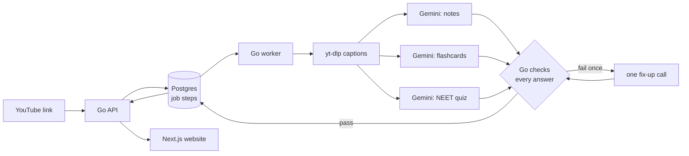

```text
██╗    ██╗ █████╗ ██████╗ ██████╗ ███████╗███╗   ██╗
██║    ██║██╔══██╗██╔══██╗██╔══██╗██╔════╝████╗  ██║
██║ █╗ ██║███████║██████╔╝██║  ██║█████╗  ██╔██╗ ██║
██║███╗██║██╔══██║██╔══██╗██║  ██║██╔══╝  ██║╚██╗██║
╚███╔███╔╝██║  ██║██║  ██║██████╔╝███████╗██║ ╚████║
 ╚══╝╚══╝ ╚═╝  ╚═╝╚═╝  ╚═╝╚═════╝ ╚══════╝╚═╝  ╚═══╝
```

**Paste a NEET lecture. Get notes beside the video, then test yourself.**

Watching a lecture feels like learning more than it is. Warden turns a YouTube lecture into revision notes that follow the video as it plays, then flashcards and an OMR answer sheet built from the same lecture. Every card and question links back to the moment it came from.

```text
┌─────────────────────────────────┬────────────────────────────────────────┐
│                                 │ 26:31  Levels of organisation          │
│              ▶ play             │        ▀▀▀▀▀▀▀▀▀▀▀▀▀▀▀▀▀▀▀▀▀▀▀         │
│                                 │        · cell → tissue → organ         │
│ ━━━━━━━━━━━━━━━━━○───── 26:40   │                                        │
│                                 │ 44:05  History: Robert Hooke           │
│ Cell: The Unit of Life          │        · coined "cell" in 1665         │
├─────────────────────────────────┴────────────────────────────────────────┤
│ notes · flashcards · answer sheet          (1) (2) (█) (4)    +4 right   │
└──────────────────────────────────────────────────────────────────────────┘
```

## How a lecture becomes study material



- **Checked, not trusted.** Gemini's answers are untrusted input. Go checks every timestamp is a real transcript line, every word is English, every quiz has four distinct options and a real answer, and every "asked in NEET" mark quotes the teacher's actual words.
- **Saved on every step.** Captions, notes, flashcards and quiz are each saved with their own marker. A crash or a retry only runs what's missing, and a lecture someone already made comes back in milliseconds with no AI call.
- **No AI SDK.** Plain HTTP from Go to Gemini, with retries when Google is busy and a clean stop when the daily quota runs out.

## What a student sees

| | |
|---|---|
| **Synced notes** | Short revision bullets, NCERT chapter name, mnemonics and a glossary. A yellow highlighter sweeps under the section being played. |
| **Focus mode** | One key narrows the light: everything except the video and the playing section falls into shade. |
| **Flashcards** | A paper index card that flips. One fact per card, each with "Watch 05:40". |
| **OMR answer sheet** | Blue-pen bubbles, scored +4 / −1 / 0 like the real paper. Direct, statement, assertion-reason and match-the-column questions. |
| **Honest progress** | The page shows the real step being worked on, and notes appear the moment they're ready. |

## Status

```text
  1  link → notes                ████████████  done
  2  NEET notes, cards, quiz     ████████████  done
  3  website + synced notes      ████████████  done
  ·  Go API, jobs, logger        ████████████  done
  4  flashcards + answer sheet   ██████████░░  built, untested
  5  revise tab                  ░░░░░░░░░░░░
  6  accounts + daily limit      ░░░░░░░░░░░░
```

## Run it locally

Needs Go, Node, yt-dlp, Docker Desktop and a Gemini key in `server/.env` as `GEMINI_API_KEY=...`.

```powershell
.\scripts\dev.ps1        # Postgres in Docker, migrations, API and worker, logs in this terminal
cd apps\web
npm install
npm run dev              # http://127.0.0.1:3000
```

The API has no login yet, so it only listens on `127.0.0.1`. Don't expose it until accounts exist.

Full plan, MVP scope and build order: [docs/PLAN.md](docs/PLAN.md). Design rules: [docs/DESIGN.md](docs/DESIGN.md). Milestones: [docs/milestones](docs/milestones/README.md).

---

## Decided so far

- Name: Warden.
- Users: NEET students. The engine stays exam-agnostic; templates and quiz style are NEET.
- Source: YouTube links only.
- Transcript: YouTube captions for now. Self-hosted Whisper later, if captions aren't good enough.
- Languages: English-medium students first. Lectures can be spoken in English, Hindi or a mix of both, as long as they teach the English terms. The website, notes, flashcards and quizzes are always in English.
- Notes: short revision bullets, with the NCERT chapter name only (no page or line numbers).
- Study material: notes, flashcards and quiz are generated separately. Card and question counts scale with lecture length. Quizzes use the NEET question mix.
- Longest lecture: about 4 hours.
- Surface: desktop web app first. No Android app or browser extension.
- Free plan: 3 notes per user per day. Every lecture counts, even when the note is reused. Retrying a failed step doesn't use a daily note.
- AI calls: from Go, straight to the providers' HTTP APIs. No SDK.
- Website: Next.js on Netlify or Vercel.
- API and worker: Go, two separate programs, both running on an Android phone (Termux).
- Public access to the API: Cloudflare Tunnel on api.<domain>.
- Data: Supabase, used only as the Postgres database. Auth is our own.

## v1 features

1. Synced notes: paste a YouTube link, get notes (title, NCERT chapter name, TL;DR, key points, sections with timestamps, mnemonics, glossary) that follow the embedded video.
2. Test yourself: flashcards and a short quiz from each note, each linking back to its moment in the video.
3. Revise tab: cards from lectures older than 2 days. No algorithm, just a date filter.
4. Login (our own auth).
5. Daily limits: 3 notes per user per day, plus a total cap (number not decided yet).
6. Library: a simple list of your past notes.

## Website look and feel (v1)

- Look: light and optimistic, "light at the end of the tunnel". Warm paper background (not pure white), warm ink text (not pure black), a soft sunny glow where your attention should be, and a yellow highlighter for the live highlight and correct answers. Full rules: [docs/DESIGN.md](docs/DESIGN.md).
- Light only in v1. All colours live in one set of named theme colours, so dark mode can be added later by adding a second set.
- Layout: video on the left and notes on the right. Later, on phones: the video sticks to the top and the notes scroll under it.
- Video: YouTube's own embedded player, privacy-enhanced version (`youtube-nocookie.com`), controlled from our page (click a timestamp to jump).
- If a video can't be embedded: still make the notes. Show them on their own, and make each timestamp open the video on youtube.com at that second.
- Character: a NEET student's desk. Yellow highlighter, blue pen, red pen, and a quiz that works like an OMR sheet with +4 and −1 marking.
- First visit: a sample lecture anyone can try before signing up.
- Touches:
  - Live section highlight: a highlighter stroke sweeps under the heading of the section being played, and scrolls it into view.
  - Flashcard flip (a paper index card), and the highlighter marks a correct quiz answer.
  - Focus mode: one key narrows the light. The edges of the page fall into soft shade; only the video and the playing section stay lit.
  - A small celebration once, at the end of a quiz: the highlighter sweeps under the score.
- Motion: short (about 0.15–0.4 s) and only to show a change. Turned off when the device asks for less motion.
- Avoid: mascots, leaderboards, sounds, looping animations, pictures beside the notes, pop-ups.

## Later (v2 or after)

- Dark mode.
- Streaks or a "days studied" count. None in v1.
- Screenshots in notes, playlists, channel digests (these cost money).
- Spaced-repetition algorithm, other exams (JEE, UPSC, college), B2B or platform partnerships, a cheap Pro plan.
- Hindi-medium students and lectures.
- Phone layout for the website.
- Export to Markdown and PDF.

## Still open

- Total daily cap on notes across all users: the number.
- Netlify or Vercel (parked until deploy, see [DEPLOYMENT.md](DEPLOYMENT.md)).
- Whether we need Whisper, and notes layout on phones: see [docs/PLAN.md](docs/PLAN.md).

How the website must look, and why: [docs/DESIGN.md](docs/DESIGN.md).

## Folders

```
apps/web/          Next.js website
  src/app/         pages
  src/components/  one folder per feature (auth, notes, library, study) + shared ui
  src/lib/         api client, website session
  e2e/             Playwright tests
server/            Go project: API + worker
  cmd/api/         API program
  cmd/worker/      worker program
  cmd/migrate/     applies database changes
  internal/        one folder per feature (auth, users, notes, study, jobs, limits)
                   + core, shared, and pipeline (captions, transcribe, llm)
  migrations/      Postgres database changes, Docker locally and Supabase later
  tests/           integration and end-to-end tests
evals/             note-quality checks
deploy/            phone and website hosting setup
docs/              architecture, milestones
scripts/           dev helpers
.github/workflows/ CI, later
```


__AMANS THOUGHTS__ 

SOMETHING LIKE WE CAN GRAB ALL THE PAST QUESTIONS FROM NEET AND THEN WHEN WE WATCH THOSE LECTURES OR PASTE THOSE NOTES THE AI GRABS THE RELEVANT QUESTIONS AND ADDS THEM IN THE QUIZ/TESTS/ETC..? 

HMM LETS THINK LETS THINK. 

AN AGENT!? HMM WILL THINK LATER.


Maybe we can create a public repository or library type shit so people can like go and well access without p;pasting links? 

AND like we don't want to focus on NEET only but JEE and other gormint exzams and like coders as well..??

hmm lets think

w